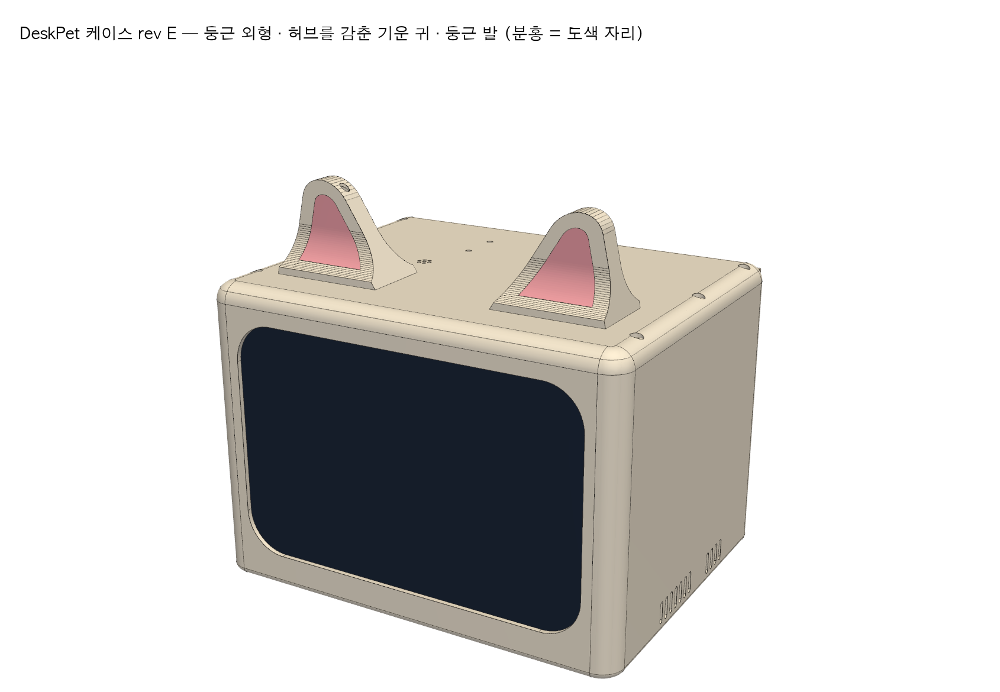
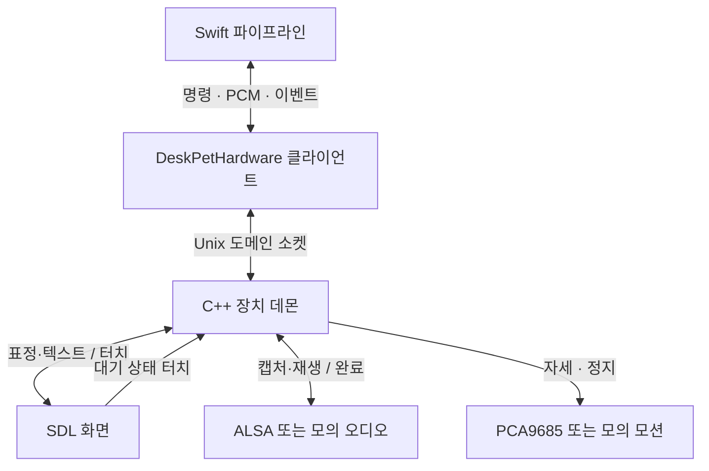

# DeskPet Hardware

DeskPet의 표정 화면, 터치, 입출력 오디오, 좌우 귀를 구동하는 C++20 데몬과 Swift 연결 패키지입니다. Jetson에서는 실제 장치를 연결하고, 개발 PC에서는 같은 통신 규약으로 가상 장치와 SDL 화면을 띄울 수 있습니다. 모델 추론과 업무 요청은 [DeskPet Pipeline](https://github.com/hansung-capstone-team-8-new-line/deskpet-pipeline)이 맡고, 이 저장소는 장치 명령을 실행해 접수·완료·실패를 보고합니다.

## 장치 구성

| 장치 | 기준 구성 | 구현 |
| --- | --- | --- |
| 컴퓨팅 | Jetson Orin Nano 8GB, JetPack 6.x / Ubuntu 22.04 | C++ 데몬과 Swift 클라이언트가 별도 프로세스로 실행 |
| 화면·터치 | Waveshare 7인치 HDMI 터치 LCD (C), 1024×600 | SDL2·SDL_ttf 표정, 한글 텍스트, 접촉과 좌표 회전 |
| 마이크·스피커 | ReSpeaker Lite, 3W 4Ω 스피커 | ALSA PCM 캡처·재생, SoXR 재표본화 |
| 좌우 귀 | PCA9685와 SG90 서보 2개 | I²C/PWM, 좌우 독립 보정, 정지 시 FULL_OFF |
| 케이스 | 전면 LCD, 귀 구동부, 탈착식 Jetson 트레이 | KiCad 배선도, build123d 모델, 3D 프린팅 파일 |



케이스 원본에는 STEP·STL·3MF, 조립 이미지, 간섭 점검과 프린팅 안내가 들어 있습니다. 케이스 치수와 실제 부품의 맞춤 여부는 원본 문서의 실측 항목을 따릅니다. [하드웨어 설계](hardware-design/README.md) · [KiCad 배선](hardware-design/kicad-wiring/README.md) · [케이스 rev E](hardware-design/case-3d/README.md)

## 런타임과 연결



- **장치별 실행.** 메인 스레드가 화면과 SDL 이벤트를 처리하고, 녹음·재생·모션은 각자 실행됩니다. 화면은 듣기·처리·발화·답변 대기 같은 활동과 감정을 표현합니다. 대기 화면의 터치는 부위와 제스처에 따라 표정·효과음으로 반응하며, 터치 이벤트는 별도로 구독할 수 있습니다.
- **연결과 명령.** 소유자만 접근 가능한 로컬 소켓에서 한 클라이언트가 제어권을 가집니다. 패킷은 길이 헤더, JSON, 선택적 PCM으로 구성됩니다. 명령과 이벤트에는 `commandId`, `jobId`, `outputId` 등 상관관계 ID를 실어 접수와 물리 완료를 구분합니다. 연결 종료 또는 유효 시간 만료 시 동작을 정리하고 화면을 대기 상태로 돌립니다.
- **오디오 수명.** 캡처는 16kHz 모노 PCM16의 20ms 프레임을 제공합니다. 재생 입력은 장치 형식으로 변환하며, 모든 PCM이 실제로 재생되고 drain이 끝나면 `audio.completed`를 보냅니다. 캡처·재생을 한 `HardwareClient`로 연결하면 Swift가 재생 전에 입력 epoch를 갱신하고, 실제 정지 확인과 300ms가 지난 뒤 새 입력을 받습니다. 정지가 확인되지 않으면 입력 차단을 유지합니다. 데몬의 짧은 터치 효과음 구간에는 캡처 시퀀스를 유지한 채 해당 프레임을 무음으로 표시합니다.
- **귀 동작과 보정.** 좌우 위치는 보정 범위 안에서 적용합니다. 보정 후 연결이 활성화되고 화면을 그리는 동안 표정에 맞춰 자동으로 반응할 수 있습니다. 수동 명령도 같은 장치 경계를 사용합니다. 오류·중단·연결 종료 때는 PWM을 끄는 경로가 있습니다.

[구현 구조](docs/architecture.md) · [장치 동작](docs/devices.md) · [소켓 프로토콜](docs/protocol.md) · [표정 카탈로그](docs/face-catalog.md)

## 개발 PC에서 실행

macOS에서는 C++20 컴파일러, CMake 3.20 이상, Python 3, SDL2, SDL2_ttf를 사용합니다. 저장소 루트에서 모의 데몬을 띄웁니다.

```sh
brew install cmake sdl2 sdl2_ttf
cmake -S . -B build -DDESKPET_LINUX=OFF
cmake --build build
./build/deskpet-hardware --config config/mock.json
```

다른 터미널의 같은 디렉터리에서 상태와 표정을 확인합니다. 각 명령은 실행 후 연결을 닫습니다.

```sh
python3 tools/deskpetctl.py health
python3 tools/deskpetctl.py face --activity listening
python3 tools/deskpetctl.py face --text '보고서 마감을 알려드릴게요.'
python3 tools/deskpetctl.py demo
```

모의 오디오는 무음이 기본이며, `audio.wavInput`에 16kHz 모노 PCM16 WAV를 지정하면 실제 시간 간격으로 프레임을 공급합니다. 화면 장치 없이 통신을 시험하려면 빌드에서 `-DDESKPET_SDL=OFF`, 실행에서 `--headless`를 사용합니다. [모의 실행과 문제 해결](docs/running.md)

## Jetson과 Swift 연결

1. 실제 화면·터치·USB 오디오·PCA9685를 연결하고 `tools/install-jetson.sh real`로 구동 환경을 준비합니다. [Jetson 설치와 배선](docs/jetson-setup.md)
2. `deskpet-hardware doctor`로 오디오 카드와 I²C 장치를 확인한 뒤 설정을 채웁니다. 화면·녹음·재생을 개별 시험하고, 귀 서보는 보정 절차를 거쳐 활성화합니다. [검증 기록](docs/validation.md)
3. Swift 패키지의 마이크·스피커·화면·모션 어댑터를 연결합니다. Python CLI와 Swift 데모는 제어 연결을 각각 열므로 한 번에 하나를 사용합니다. [Swift 데모 코드](swift/Sources/DeskPetHardwareDemo/main.swift)
4. 음성 모델과 Harness까지 함께 배포하려면 제품 런처를 사용합니다. 화면만 상시 구동하는 설치 형태는 키오스크 문서를 따릅니다. [DeskPet Product](https://github.com/hansung-capstone-team-8-new-line/deskpet-product) · [키오스크 모드](docs/kiosk.md)

```sh
swift build --package-path swift
swift run --package-path swift deskpet-swift-demo
ctest --test-dir build --output-on-failure
swift test --package-path swift
```

소프트웨어 검사에는 소켓 통신, PCM 순서와 완료, 장치 오류와 취소, 화면 상태, 터치 좌표, 서보 보정 제약이 포함됩니다. 실물 검증에서는 여기에 USB 장치 식별, 터치·스피커·서보 동작과 보드 반복 실행을 더 확인합니다. [보드 시험 절차](docs/board-test.md)
