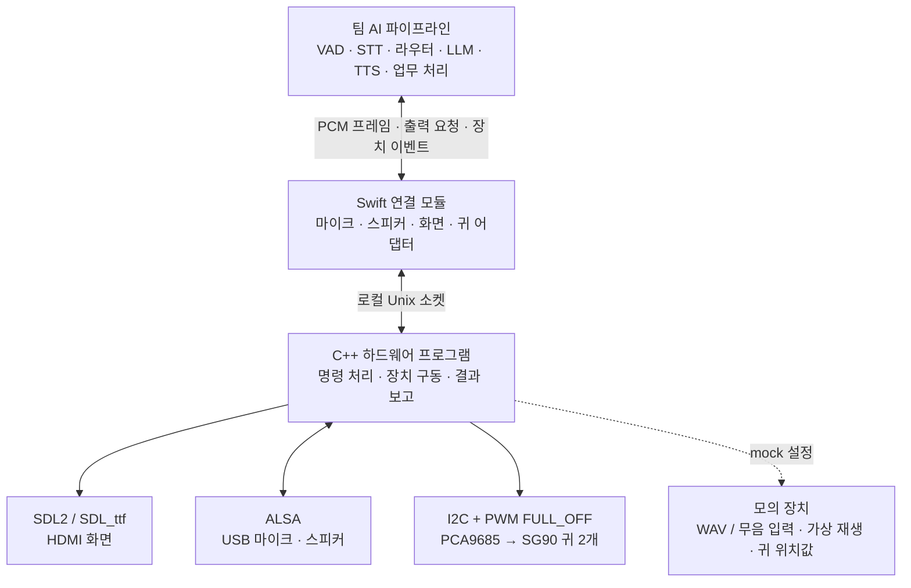

# 구현 개요

현재 구성은 **2026-10-16 발주 기준: 10.1인치 IPS 터치 LCD(1024×600, mini HDMI·USB-C 터치), ReSpeaker Lite Voice Assistant Kit(보드+밀폐형 스피커), PCA9685 OE=GND**입니다. GPIO OE·HC125 배선은 사용하지 않습니다. 부품은 아직 도착 전이며(LCD 11/3, 음성 키트 11/4 예정) 터치 원시 입력·Swift·팀 파이프라인 전달은 구현했습니다. 실제 패널 검증과 터치에 따른 제품 동작은 남아 있습니다.

이 저장소는 **DeskPet의 화면·마이크·스피커·귀를 제어하는 실행 프로그램과 Swift 연결 모듈**입니다. AI 파이프라인이 “듣는 표정으로 바꿔”, “이 음성을 재생해”, “귀를 흔들어”라고 요청하면 장치 동작으로 바꾸고 접수·완료·오류를 돌려줍니다. STT·LLM·TTS와 업무 판단은 팀 파이프라인에서 연결합니다.

진행 상태와 남은 일은 팀 위키의 [하드웨어 진행상황](https://github.com/hansung-capstone-team-8-new-line/knowledge/blob/master/wiki/deskpet-hardware.md)에서 관리합니다.

## 읽는 순서

| 찾는 내용 | 읽을 문서 |
| --- | --- |
| 전체 구조·어떤 프로그램인지 | 이 문서 |
| 마이크·스피커·귀·화면의 실제 동작 | [장치 동작](devices.md) |
| 출력 모델의 필드·허용값·표정 매핑 | [표정 명세(위키)](https://github.com/hansung-capstone-team-8-new-line/knowledge/blob/master/wiki/deskpet-display-interface.md) |
| Swift 화면 호출·전환 시점·이전 응답과 타이머 처리 | [화면 연결 예제(위키)](https://github.com/hansung-capstone-team-8-new-line/knowledge/blob/master/wiki/deskpet-display-integration.md) |
| 공통 Swift 연결·소켓 형식·ID·응답·오류 | [통신 계약](protocol.md) |
| 모의 실행·표정 시험·문제 해결 | [모의 실행과 문제 해결](running.md) |
| Jetson 설치·배선·귀 보정 | [Jetson 설치](jetson-setup.md) |
| 주변 장치 없이 보드 진단·빌드·30분 시험·배포 | [10/26 보드 실행 안내](board-test.md) |
| 통과한 검사·팀 연결 기준·실물 점검표 | [검증 기록](validation.md) |
| 회로도·배선 원본과 검증 도구 | [하드웨어 설계 자료](../hardware-design/README.md) |

출력 모델 담당자는 **표정 명세 → 화면 연결 예제**, 장치 담당자는 **모의 실행 → 장치 동작 → Jetson 설치 → 검증 기록** 순서로 읽으면 됩니다. 소켓을 직접 구현할 때 통신 계약을 참고합니다.

## 구성 요소

| 구성 요소 | 실제로 하는 일 | 주요 파일 |
| --- | --- | --- |
| C++20 장치 프로그램 | 화면을 그리면서 녹음·재생·귀 동작을 독립적으로 처리 | `src/main.cpp`, `runtime.cpp`, `server.cpp` |
| 화면 렌더러 | 두 눈·입 애니메이션, 동작 상태·결과 표시, 한글 안내 | `src/display.cpp` |
| 터치 입력 | SDL 접촉·좌표·회전 변환, 이동 이벤트 합치기, 선택적 소켓 구독 | `src/display.cpp`, `server.cpp`, `swift/Sources/DeskPetHardware/Touch.swift` |
| 음성 입출력 | USB 마이크 PCM 수집, 전달받은 PCM 재생, 완료·중단·유실 보고 | `src/audio.cpp`, `audio_alsa.cpp` |
| 귀 제어 | PCA9685 PWM, 좌우 보정값 적용, FULL_OFF 활성화·차단 | `src/motion.cpp`, `motion_linux.cpp` |
| Swift 연결 패키지 | 팀 파이프라인에서 녹음·재생·화면·귀를 호출할 인터페이스 제공 | `swift/Sources/DeskPetHardware/` |
| 시험 도구 | 상태 조회, 표정·녹음·재생·보정·통합 데모 | `tools/deskpetctl.py` |
| 설치·시작 구성 | Jetson 의존성 설치, 장치 접근 권한, 그래픽 로그인 후 실행 | `tools/install-jetson.sh`, `deploy/` |
| 자동 검사 | 잘못된 메시지, 취소, 큐 포화, 단절, 화면 교체, Swift 통신 검사 | `tests/`, `swift/Tests/` |

## 시스템 내 위치



C++와 Swift는 같은 기기에서 서로 다른 프로세스로 실행합니다. Swift가 C++ 내부 포인터를 직접 다루는 구조 대신 로컬 소켓으로 연결합니다. 화면은 주 실행 스레드에서 처리하고 녹음·재생·모션은 각각 별도 스레드에서 진행하므로, 재생 도중에도 원시 캡처는 유지합니다. Swift 입력 게이트는 STT로 넘길 프레임을 차단합니다.

## 책임 경계

| 하드웨어 프로그램이 담당 | 팀 파이프라인이 담당 |
| --- | --- |
| PCM 수집·재생과 장치 오류 보고 | VAD·STT·반향 제거·TTS 추론 |
| 요청된 표정·문구·귀 동작 실행 | 답변 문구·감정·업무 결과 결정 |
| ID 보존, 출력 교체, 접수·완료·실패 구분 | 서로 다른 요청의 유효성·우선순위·취소 정책 |
| 명시적 중단, 연결 만료 시 장치 정리 | 음성 실패 후 텍스트로 전환할지 결정 |
| 장치 상태·보정 여부 제공 | 텍스트 15초 종료, 질문 대기, 리마인더 타이머 |

따라서 음성 출력이 실패했다고 이미 성공한 업무를 다시 실행하지 않습니다. 데모는 파이프라인이 담당할 일부 정책을 시험용으로 재현하지만 하드웨어 서버 자체에 업무 정책을 넣지는 않습니다. 터치는 원시 접촉 이벤트를 전달하며 기본 소비는 진단 기록입니다. 쓰다듬기·재생 중지·업무 실행 같은 제품 동작과 추가 센서는 이번 범위 밖입니다.

팀 저장소의 `DeskPetHardwareIntegration`은 단일 `HardwareClient`·이벤트 소비자를 공유합니다. 재생 전 입력 epoch를 무효화하고 VAD를 초기화하며, 실제 종료+300ms 및 듣기 화면 ack 이후 새 프레임만 전달합니다. `deskpet-board`는 실제 Unix 소켓으로 팀 파이프라인을 실행하되 모델·외부 업무는 fixture를 사용합니다. 두 저장소를 형제 폴더에 배치합니다.

## 저장소 구조

```text
deskpet-hardware/
├── CMakeLists.txt              # C++20 빌드
├── include/deskpet/            # 공통 형식과 장치 인터페이스
├── src/                        # 화면·음성·귀·소켓·실행 코드
├── config/mock.json            # 하드웨어 없는 모의 설정
├── config/jetson.json          # 실물 설정 시작점, 보정 전 귀 비활성
├── swift/                      # Swift 라이브러리·실행 예제·단위 검사
├── tools/                      # 진단·데모·설치·Linux 검사 도구
├── deploy/                     # systemd 사용자 서비스·udev·검증 컨테이너
├── tests/                      # C++·통합·화면 검사
├── docs/                       # 구조·장치·통신·설치·검증 문서
├── hardware-design/            # KiCad 회로도·배선 원본과 검증 도구
└── third_party/                # 고정 버전 JSON 헤더와 라이선스
```

## 남은 확인

실제 USB 장치·Jetson 그래픽 환경·귀 기구·반향 제거 성능·새 입력 epoch를 포함한 팀 통합은 [검증 기록](validation.md)의 남은 항목을 따라 확인합니다.
