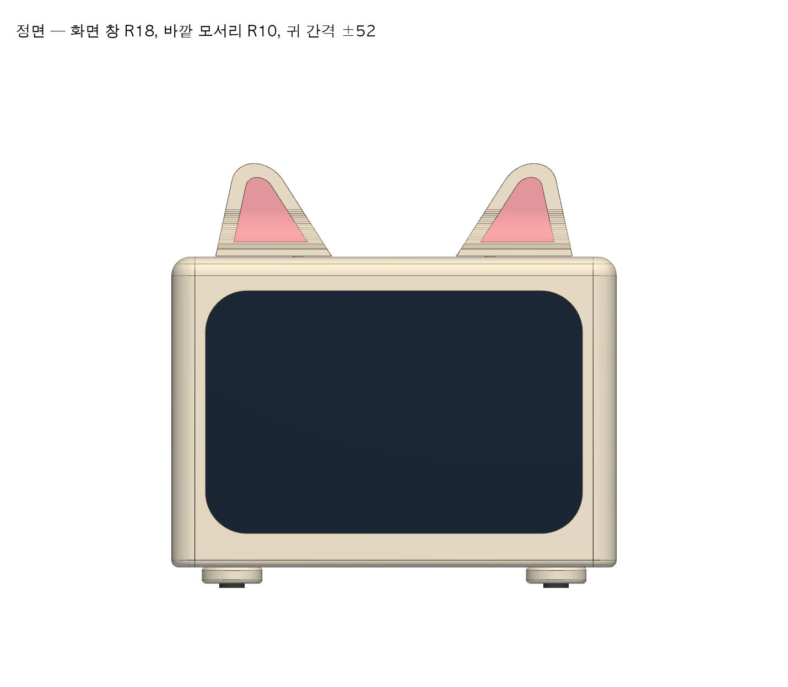
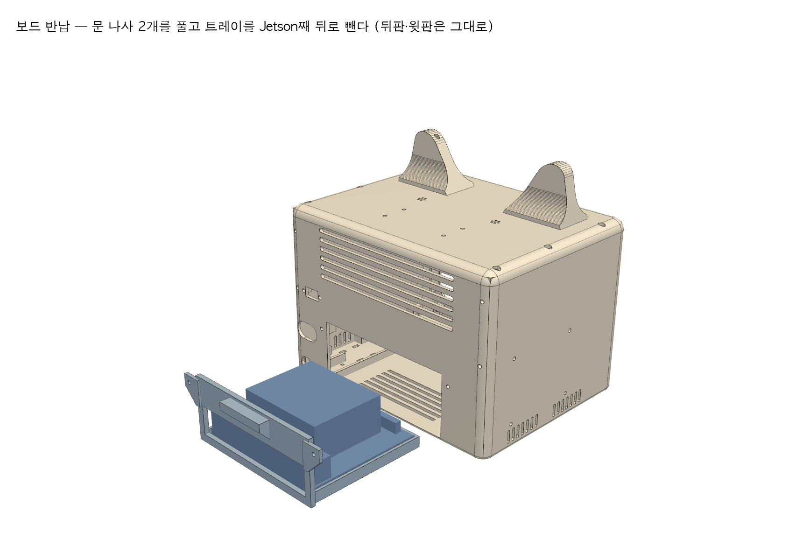
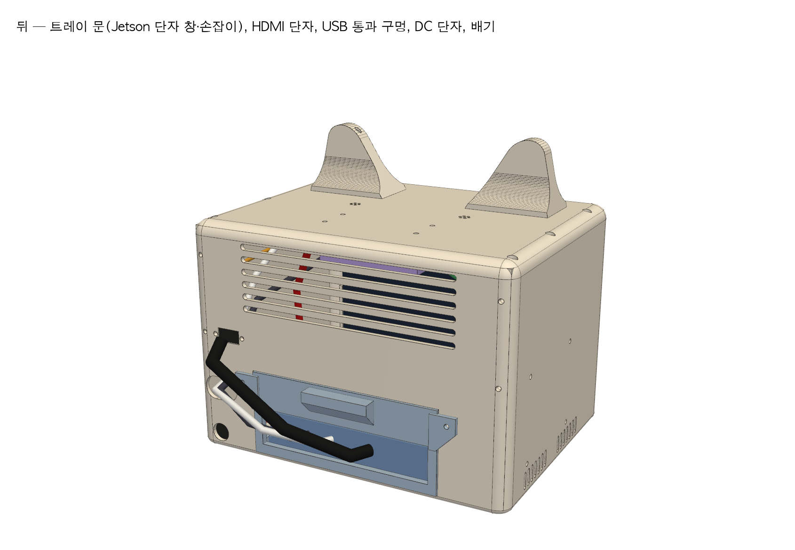

# DeskPet 케이스 3D 모델 (rev E — 앞면 전체 LCD · 둥근 외형)

실제 부품·배선을 같은 좌표에 넣고 겹침·통로를 자동 검사하는 케이스 모델입니다. [케이스 설계 위키](https://github.com/hansung-capstone-team-8-new-line/knowledge/blob/master/wiki/deskpet-enclosure-design.md)의 처음 형태 **직육면체 몸통 · 앞면 전체 7인치 LCD · 윗면 고양이 귀**를 그대로 따릅니다. **외형 192 × 134 × 150 mm**(귀 포함 높이 174, 발·범퍼 9 mm 별도)입니다. rev E는 rev D와 크기·내부 구조가 같고, "외관이 충분히 귀엽지 않다"는 평가에 따라 바깥 모양을 다듬고 그에 맞춰 내부 배치를 옮겼습니다. 출력물 8종은 Bambu Lab **H2D에서 본 출력 2회(각 300 g 한도 안)** 로 뽑습니다. 계획·설정·도색은 [PRINTING.md](PRINTING.md)에 있습니다.

부품 도착 전 계획 치수입니다. `[추정]` 값을 실측해 고친 뒤 다시 만들어야 본 출력할 수 있습니다(맨 아래 표).

| 조립 완성 | 정면 |
| --- | --- |
|  |  |
| **보드 반납: 문 나사 2개 → 트레이째 빼기** | **뒤 (트레이 문·단자)** |
|  |  |

[내부 (뒤·오른쪽)](renders/03-inside-back-right.png) · [내부 (앞·왼쪽)](renders/03b-inside-front-left.png) · [윗판 아래](renders/04-top-plate-underside.png) · [출력물 분해도](renders/05-exploded.png) · [검사 결과](check-report.txt)

## rev D에서 바꾼 것 (rev E)

| 항목 | rev D | rev E | 이유 |
| --- | --- | --- | --- |
| 바깥 모서리 | 앞 세로 R4만 둥금 | **앞 세로 R10 · 뒤 세로 R8 · 위 R8 · 아래 R3** | 각진 상자 인상을 없앰. 앞 세로 R10이 상한(더 키우면 안쪽 채움이 LCD 유리 x 13.55에 닿음). 위 모서리 때문에 얇아지는 옆벽·뒤판 맨 위는 안쪽에 3 mm 덧댐 |
| 화면 창 | R2 | **R18** | 화면이 아니라 얼굴로 보이게. 표시 영역 모서리가 가려지지 않는 상한은 약 R23 |
| 귀 모양 | 밑변 36 · 끝 R4 뾰족한 삼각형, 허브 원판이 드러남 | **밑변 50 · 끝 R12, 바깥으로 12° 기울임(전단이라 밑변은 평평).** 아래가 오목한 곡면으로 두께 31까지 벌어지는 **귀 뿌리**에 허브를 숨김(밑은 열림) | 교통 콘처럼 보이던 귀를 고양이 귀로. 허브는 가운데 기둥 Ø14 + 멈춤 홈 원판 Ø30 × 3으로 가볍게 해 귀 1개 8.8 g(상한) |
| 귀 위치 | 축 간격 ±60, 앞에서 52 | **±52, 앞에서 40** | 얼굴과 한 덩어리로 보이게 안쪽·앞쪽으로 |
| 귀 안쪽 색 | 2색 출력 분홍 장식(0.8 mm 붙임) | **0.4 mm 낮춘 도색 자리** (시타델 도료로 칠함, 아래 벽 0.8 mm) | 도색으로 바꿔 2색 출력 불필요. 턱이 붓질 경계선 |
| 혼 팔 홈 | 앞뒤 양쪽 | **뒤쪽 한 방향** | 귀 앞면에 홈이 보이지 않게. SG90 혼 팔 하나를 13 mm로 잘라 씀 |
| 발 | 바닥에 실리콘 범퍼 직접 | **P8 둥근 발 Ø26 × 7 ×4**, 범퍼를 3 mm 묻어 2 mm만 보임. M2.5 × 8을 아래에서 올려 바닥판 안쪽 너트 | 검은 범퍼가 정면에서 덜 보이고 장난감처럼 보임. 구매한 범퍼 그대로 사용 |
| ReSpeaker | 윗판 아래 y 22~57 | **뒤로 34 mm (y 56~91)**, 레일·끝막이·마이크 구멍 같이 이동 | 앞으로 나온 귀 서보·USB-C 플러그와 겹침 |
| 배선 | — | ReSpeaker USB, 스피커 JST, 귀 서보선 경로 다시 잡음 | 서보선은 ReSpeaker(아래면 z 120) 밑으로 지나 PCA9685로 |
| 출력판 | X1C 2장 + H2D 2장 | **H2D 3장**: 맞춤 시험(27 g), 1회차 P2·P4·P5(252 g), 2회차 P1·P3·P6·P7·P8(246 g) | H2D 한 번 300 g 한도. 퍼지·브림 몫 10%를 남겨 물체 270 g 이하를 `build.py`가 검사 |

구매 부품은 10-26 재구매 21종과 추가 구매(HDMI FPC 리본 키트, ㄱ자 micro USB 케이블) 그대로이고 새로 살 것은 없습니다.

## rev C에서 바꾼 것 (rev D)

| 항목 | rev C | rev D | 이유 |
| --- | --- | --- | --- |
| 앞면 | 204 × 122, 창 156 × 88, 오른쪽 케이블 칸 30 | **192 × 128 앞틀에 LCD 유리 164.9 × 107(72%)**, 테두리 사방 13.5 | "앞면 전체 LCD" 원래 형태. 위·아래 테두리는 LCD 모서리 나사 탭(높이 124.27)이 정하고, 같은 폭으로 좌우를 맞춤 |
| LCD 고정 | 위에서 밀어 넣고 윗판 리브로 누름 | **LCD 모서리 탭 4곳을 앞틀 보스에 M2.5 나사**(LCD 동봉 나사 사용 가능, 너트는 보스 옆 홈) | Waveshare 치수도의 탭 구멍(156.9 × 114.96)을 그대로 씀. 윗판을 열어도 LCD가 흔들리지 않음 |
| LCD 단자 | 일자 → ㄱ자 HDMI 젠더 + ㄱ자 micro USB, 케이블 칸 30 | **HDMI FPC 리본 키트(ㄱ자 A수 ↔ A암 패널형) + ㄱ자 micro USB**를 오른쪽 테두리 안 11 mm에 숨김. HDMI는 뒤판 패널 단자로 나감 | 케이블 칸을 없애려면 플러그 돌출이 약 9 mm 이하여야 함. 일반 ㄱ자 젠더(20 mm 이상)는 안 들어감 |
| 보드 탈착 | 뒤판(나사 4개)을 열고 트레이를 뺌 | **트레이와 뒤 문이 한 몸(P5). 문 나사 2개만 풀고 손잡이로 뒤로 끝까지 뺌** | 반납할 때 케이스를 분해하지 않음. 뒤판·윗판·바닥판과 다른 부품은 그대로 |
| Jetson 케이블 | 단자에 꽂고 뒤판 통과 구멍으로 다시 들어옴 | 같음. 다만 HDMI는 뒤판 **패널 HDMI 단자**에 짧은 HDMI 케이블로 연결 | 반납 때 바깥 케이블만 뽑으면 됨 |
| 귀 | 속 빈 삼각형 + 혼 자리 | **둥근 끝 삼각형 + 허브 아래 부채꼴 홈, 윗판에 M2.5 멈춤 나사** → 약 ±32°에서 기계적으로 멈춤. 앞면 안쪽 귀 장식(2색) | 위키의 "케이스에 멈춤턱" 요구. 서보가 멈춤턱에 걸려 스톨하지 않도록 소프트웨어 ±25° < 멈춤 ±32° |
| 외관 | 각진 모서리 | 앞쪽 세로 모서리 R4, 옆면 아래 흡기 슬롯 | 흡기는 바닥 뒤·옆면 아래, 배기는 뒤판 위 (위키 냉각 규칙) |
| 프린터 | 학교 프린터 220 × 220 × 250 가정 | **X1C 256³ / H2D 325 × 320 × 325**, 출력 방향으로 돌린 STL과 출력판 3MF | 사용 가능 프린터 확정 |

## 파일

| 파일 | 내용 |
| --- | --- |
| `deskpet_case.py` | 치수 표 + 출력물 P1~P8, 구매 부품 더미, 배선 경로. **치수는 맨 위 표 한 곳에서만 고친다** |
| `build.py` | 모델 생성 → 검사 → STEP·STL·3MF·그림 내보내기. 검사 실패 시 exit 1 |
| `deskpet-case-assembly.step` | 전체 조립품(출력물·부품·배선, 색·이름 포함). Fusion 360·Onshape·FreeCAD에서 열어 수정 |
| `stl/` | **출력 방향으로 돌려 둔** STL (mm). 귀는 왼쪽·오른쪽이 다름(멈춤 홈·기운 방향). 발은 1개 파일(4개 출력) |
| `3mf/` | H2D 출력판 3장: 맞춤 시험 `H2D-0`, 본 출력 `H2D-1`·`H2D-2` (각 300 g 한도 안). 계획·설정은 [PRINTING.md](PRINTING.md) |
| `renders/` | 미리보기 그림 8장 |
| `check-report.txt` | 마지막 검사 결과 |

## 다시 만들기

저장소 루트에서 실행합니다(Windows PowerShell 기준, macOS·Linux는 `.venv/bin/python`).

```sh
python -m venv .venv
.venv\Scripts\python -m pip install -r hardware-design/case-3d/requirements.txt
.venv\Scripts\python -X utf8 hardware-design/case-3d/build.py
```

약 30초 걸립니다. 출력 폴더를 인자로 주면 그곳에 만듭니다.

## 검사하는 것

| 검사 | 기준 |
| --- | --- |
| 겹침 | 출력물·부품 모든 쌍의 교집합 부피 ≤ 0.5 mm³ (면 접촉은 허용). 발 나사·범퍼 포함 |
| 배선 | 케이블 11가닥이 출력물을 뚫지 않음 (뒤판 통과 구멍·문 창으로만 나감) |
| 냉각 | Jetson 방열판 위 30 mm 공기층에 부품·케이블 없음 |
| 귀 회전 | 귀가 서보 축 기준 ±30° 돌 때 멈춤 나사를 포함해 아무것과도 안 부딪힘 |
| 귀 멈춤턱 | ±40°까지 돌리면 멈춤 나사에 걸림 (기계식 멈춤이 실제로 동작하는지) |
| 보드 반납 | **뒤판을 열지 않고** 트레이·문·Jetson이 뒤로 끝까지 빠지는 통로가 비어 있음 |
| 귀 무게 | 귀 1개 ≤ 10 g (속 채움 100% 상한으로 계산, 현재 8.8 g) |
| 출력 | 출력 방향 기준으로 H2D 출력 범위 안 |
| 출력 무게 | H2D 출력판마다 물체 무게(속 채움 100% PETG 상한) ≤ 270 g (한 번 300 g − 퍼지·브림 10%) |

검사가 진짜 잡는지 개발 중 확인했습니다. 문 두께를 늘리면서 Jetson 단자 창이 끝까지 뚫리지 않아 USB·HDMI 케이블이 문을 관통한 것을 잡아 고쳤습니다. 자동 검사가 못 잡는 모양 문제는 그림으로 확인합니다: rev E 작업 중 귀 뿌리 속 비우기가 바깥면을 뚫은 것을 확대 그림으로 찾아 고쳤습니다.

## 출력물

| 번호 | 크기 (mm, 출력 방향) | 출력 방향 | 내용 |
| --- | --- | --- | --- |
| P1 바닥판 | 192 × 150 × 10 | 그대로 | 스피커 창, 흡기, 트레이 레일, DC 단자 받침, 퓨즈 홀더 타이 구멍, 발 나사 구멍 4 |
| P2 몸통 | 192 × 128 × 148 | **앞면을 바닥에** | 앞틀(창 162.9 × 105, R18)·LCD 탭 보스 4·좌우 위치 맞춤 리브·좌우 벽(흡기)·결합 보스(45° 경사, 서포트 없음) |
| P3 윗판 | 188 × 146 × 10 | 윗면을 바닥에 | 귀 축 구멍·멈춤 나사 구멍·서보 보스, 마이크 구멍, ReSpeaker 레일, PCA9685 구멍 |
| P4 뒤판 | 187 × 128 × 10 | 바깥면을 바닥에 | 아래 가운데 트레이 문 홈, 패널 HDMI 단자 자리, USB 통과 구멍, DC 단자 Ø11, 배기, 문 나사 너트 보스 |
| P5 트레이+문 | 136 × 106 × 49 | 그대로 | 키트 받침대째 끼움(나사 없음), 바닥 환기, 뒤 문(Jetson 단자 창 104 × 22, 손잡이, 나사 탭 2) |
| P6 귀 왼쪽·오른쪽 | 50 × 31 × 40 | 뿌리 밑면을 바닥에 | 기운 둥근 끝 속 빈 삼각형(벽 1.2) + 오목한 귀 뿌리, 혼 홈(뒤쪽), 멈춤 홈, 앞면 도색 자리 0.4 |
| P7 스피커 받침 | 74 × 34 × 6 | 그대로 | 스피커 둘레 틀, EVA 자리 |
| P8 발 ×4 | Ø26 × 7 | 위면을 바닥에 | 범퍼 자리 Ø11.6 × 3, 나사 머리 자리 |

결합은 M2.5 나일론 나사 + 너트(BRT 세트)입니다: 판 결합 15쌍(P1 5, P3 6, P4 4), 문 2, LCD 탭 4, 귀 멈춤 2, HDMI 단자 보드 2, 발 4(M2.5 × 8). 너트는 보스 옆 홈(발은 바닥판 안쪽)에 끼웁니다.

## 보드 반납 순서

1. 모든 전원을 끄고 Jetson 뒤 단자의 케이블(전원, DP 젠더, USB 2개)을 뽑는다. 다른 쪽 끝은 케이스에 남는다.
2. 문 나사 2개(뒤판 아래 좌우)를 풀고 손잡이를 잡아 트레이를 뒤로 끝까지 뺀다.
3. 밖으로 나온 Jetson 앞쪽 40핀 헤더에서 리본을 뽑는다(리본 20 cm면 여유가 남음).
4. 받침대째 Jetson을 들어낸다(나사 없음). SD카드는 팀 소유라 빼서 보관한다.

다시 장착할 때는 거꾸로 합니다. 리본 1번 방향을 확인한 뒤 트레이를 밀어 넣습니다.

## 실측 후 고칠 값

`deskpet_case.py` 맨 위 치수 표에서 `[추정]`으로 표시한 값입니다.

| 항목 | 지금 값 | 영향 |
| --- | --- | --- |
| LCD 유리 앞면 → 탭 앞면 거리 (`LCD["tab_y"]`) | 5.5 | 앞틀 탭 보스 높이. 틀리면 유리가 앞틀에 안 닿거나 들뜸 |
| LCD 단자 위치 (`hdmi_dz`, `usb_dz`, `*_yc`) | 위 끝에서 16·37 (Waveshare 치수도에서 잼) | 오른쪽 플러그 자리, 위치 맞춤 리브 높이 |
| HDMI FPC ㄱ자 플러그 돌출 | 8.6 (LCD 끝 → 플러그 끝) | 오른쪽 여유 11.1 mm 안에 들어가야 함. 넘으면 `CASE["W"]`를 키움 |
| HDMI 패널 단자 보드 크기·구멍 | 창 14 × 8, 구멍 간격 18 | 뒤판 HDMI 자리 |
| Jetson 받침대 높이·단자 줄 위치 (`JET`) | 높이 35, 단자 줄 높이 16 | 트레이, 문 단자 창 |
| PCA9685 구멍 간격 (`PCA`) | 55.9 × 19.1 | 윗판 구멍 |
| SMP0080 크기·구멍 (`GPIO`) | 66 × 55 | 왼쪽 벽 지지대 위치 |
| ReSpeaker 마이크 위치 | 양 끝에서 8 mm | 윗판 마이크 구멍 |
| SG90 혼 지름·팔 길이 | 가운데 Ø7.4, 팔 폭 6.4, 13 mm로 자름 | 귀 허브 홈 |
| ReSpeaker USB-C 플러그 몸통 길이 | 15.5 | 오른쪽 귀 서보와의 간격 |
| 스피커 선 길이 (Adafruit 3351) | 경로 약 12 cm 필요 | ReSpeaker를 뒤로 옮겨 길어짐. 짧으면 JST 연장선 |
| 발 나사 M2.5 × 8 | BRT 세트에 있다고 가정 | 없으면 × 10도 됨 (바닥판 안쪽으로 2 mm 더 나옴, 그 위에 부품 없음) |

**출력 전 LCD 맞춤 시험:** P2를 출력하기 전에 `3mf/H2D-0-P2-fit-test.3mf`(P2 앞쪽 12 mm, 27 g 상한)로 LCD 탭 보스·창·단자 자리와 둥근 모서리 첫 층을 확인하세요([PRINTING.md](PRINTING.md)).

배선 경로(`CABLES`)는 끝점 위치와 대략의 경로만 맞춘 것이며, 케이블 굽힘 반경과 실제 길이는 조립하면서 확인합니다.
