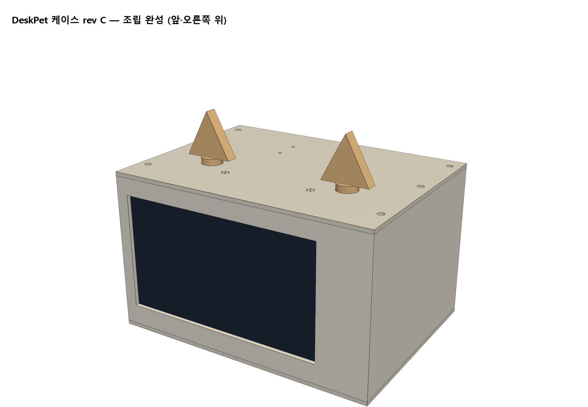
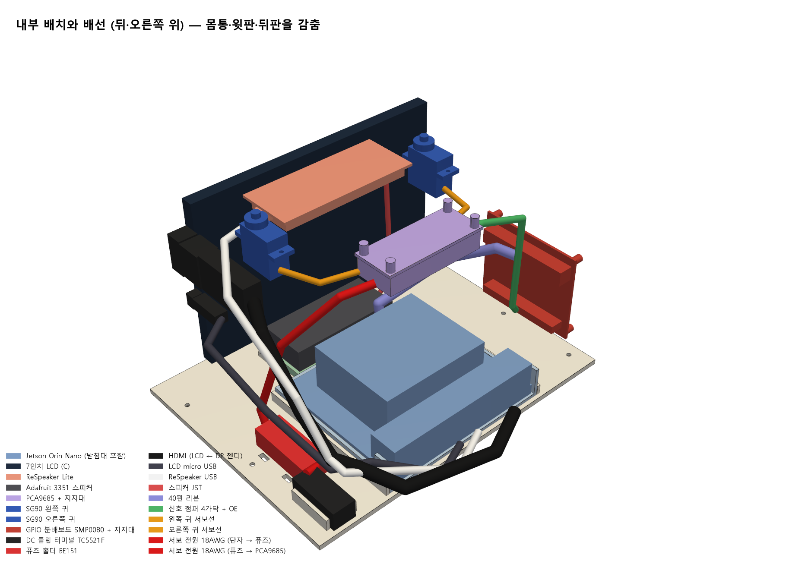
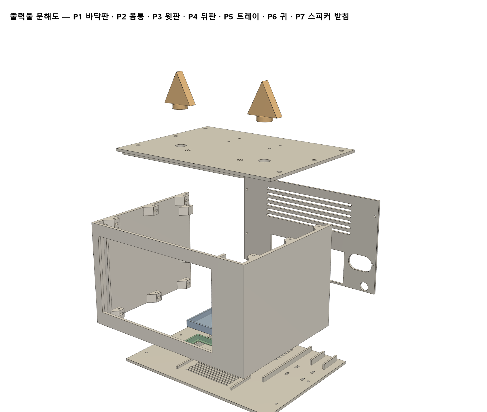

# DeskPet 케이스 3D 모델 (rev C)

실제 부품·배선을 같은 좌표에 넣고 겹침·통로를 자동 검사하는 케이스 모델입니다. [케이스 설계 위키](https://github.com/hansung-capstone-team-8-new-line/knowledge/blob/master/wiki/deskpet-enclosure-design.md)의 계획안 rev C(204 × 122 × 150 mm)를 출력 가능한 형상으로 만들었습니다. **부품 도착 전 계획 치수**이며, `[추정]` 값을 실측해 고친 뒤 다시 만들어야 본 출력할 수 있습니다.



| 내부 (뒤·오른쪽 위) | 출력물 분해도 |
| --- | --- |
|  |  |

[뒤에서 본 모습](renders/02-back.png) · [앞·왼쪽에서 본 내부](renders/03b-inside-front-left.png) · [윗판 아래](renders/04-top-plate-underside.png) · [검사 결과](check-report.txt)

## 파일

| 파일 | 내용 |
| --- | --- |
| `deskpet_case.py` | 치수 표 + 출력물 P1~P7, 구매 부품 더미, 배선 경로. **치수는 맨 위 표 한 곳에서만 고친다** |
| `build.py` | 모델 생성 → 검사 → STEP·STL·그림 내보내기. 검사 실패 시 exit 1 |
| `deskpet-case-assembly.step` | 전체 조립품(출력물·부품·배선, 색·이름 포함). Fusion 360·Onshape·FreeCAD에서 열어 수정 |
| `stl/` | 출력용 STL (원점 정렬, mm). 귀는 `P6-ear-x2.stl`을 2개 출력 |
| `renders/` | 미리보기 그림 6장 |
| `check-report.txt` | 마지막 검사 결과 |

## 다시 만들기

저장소 루트에서 실행합니다(Windows PowerShell 기준, macOS·Linux는 `.venv/bin/python`).

```sh
python -m venv .venv
.venv\Scripts\python -m pip install -r hardware-design/case-3d/requirements.txt
.venv\Scripts\python -X utf8 hardware-design/case-3d/build.py
```

약 10초 걸립니다. 출력 폴더를 인자로 주면 그곳에 만듭니다.

## 검사하는 것

| 검사 | 기준 |
| --- | --- |
| 겹침 | 출력물·부품 모든 쌍의 교집합 부피 ≤ 0.5 mm³ (면 접촉은 허용) |
| 배선 | 케이블 10가닥이 출력물을 뚫지 않음 (뒤판 통과 구멍으로만 나감) |
| 냉각 | Jetson 방열판 위 30 mm 공기층에 부품·케이블 없음 |
| 귀 | 귀가 서보 축 기준 ±30° 돌 때 아무것과도 안 부딪힘 |
| 정비 | 뒤판을 열고 Jetson 트레이를 뒤로 빼는 통로가 비어 있음 |
| 출력 | 출력물마다 220 × 220 × 250 mm 안에 들어감 |

검사가 진짜 잡는지는 개발 중 확인했습니다. 처음 모델에서 스피커 받침이 트레이 통로를 0.5 mm 침범한 것, 귀 허브가 SG90 기어 탑에 닿은 것, ReSpeaker USB 케이블이 뒤판 구멍 가장자리를 스친 것을 잡아 고쳤습니다.

## 출력물

| 번호 | 크기 (mm) | 출력 방향 | 내용 |
| --- | --- | --- | --- |
| P1 바닥판 | 204 × 150 × 10 | 그대로 | 스피커 창, 흡기, 트레이 레일, DC 단자 받침, 퓨즈 홀더 타이 구멍, 범퍼 자리 |
| P2 몸통 | 204 × 150 × 116 | **앞면을 바닥에** (높이 150) | 앞틀(창 156 × 88)·LCD 포켓·좌우 벽·결합 보스. 보스 아래 45° 경사로 서포트 없이 출력 |
| P3 윗판 | 204 × 150 × 10 | 윗면을 바닥에 | 귀 축 구멍·서보 보스, 마이크 구멍, ReSpeaker 레일, PCA9685 구멍, LCD 누름 리브 |
| P4 뒤판 | 196 × 116 × 2.5 | 그대로 | Jetson 단자 창 110 × 42, 케이블 통과 구멍 32 × 20, DC 단자 Ø11, 배기 |
| P5 트레이 | 109 × 94 × 19 | 그대로 | 나사 없이 키트 받침대째 끼움, 바닥 환기, 뒤쪽 손잡이 |
| P6 귀 ×2 | 36 × 16 × 39 | 허브를 바닥에 | 속 빈 삼각형(벽 1.2), 혼 자리 |
| P7 스피커 받침 | 74 × 34 × 6 | 그대로 | 스피커 둘레 틀, EVA 자리 |

결합은 M2.5 나일론 나사 + 너트 15쌍입니다(P1 5, P3 6, P4 4). 너트는 보스 옆 홈에 끼웁니다. 속 채움 100% 기준 최대 약 550 g이며, 20~30%로 출력하면 그보다 훨씬 가볍습니다.

## 위키 계획에서 바꾼 것

모델을 실제 부품과 맞추면서 아래를 바꿨습니다. 팀 확인이 필요합니다.

1. **LCD는 위에서 밀어 넣고 윗판 리브로 누릅니다.** 포켓 왼쪽 테두리가 4 mm라 P9 누름쇠 보스를 둘 자리가 없었습니다. 포켓 위를 열어 두고, 뒤쪽 턱과 P3 리브(EVA)로 고정하므로 P9가 필요 없습니다.
2. **LCD 단자에는 ㄱ자 HDMI 젠더와 ㄱ자 micro USB 케이블이 필요합니다.** 일자 플러그는 LCD 끝에서 약 60 mm(플러그 + 꺾임)가 필요한데 케이블 칸은 30 mm입니다. **추가 구매 2개**(각 수천 원)입니다.
3. **Jetson 단자는 뒤판 창으로 밖에서 꽂습니다.** Jetson 단자면과 뒤판 사이가 1.5 mm라 안쪽에서 꽂을 공간이 없습니다. LCD·ReSpeaker 케이블은 뒤판의 통과 구멍으로 다시 들어옵니다. 반납할 때 뒤판을 열지 않고도 케이블을 뺄 수 있습니다.
4. **GPIO 분배보드는 왼쪽 벽에 세워 붙입니다.** Jetson 왼쪽 빈 폭이 약 44 mm라 바닥에 눕힐 수 없습니다.
5. **귀 서보는 몸통이 앞뒤 방향**입니다. 좌우로 두면 ReSpeaker와 겹칩니다.
6. **P8 케이블 클램프는 빼고** 케이블 타이로 묶습니다. 퓨즈 홀더는 바닥 타이 구멍에 묶습니다.

## 실측 후 고칠 값

`deskpet_case.py` 맨 위 치수 표에서 `[추정]`으로 표시한 값입니다.

| 항목 | 지금 값 | 영향 |
| --- | --- | --- |
| LCD 단자 높이 (`LCD_PORTS`) | HDMI z 88, micro USB z 55 | 포켓 오른쪽 벽 홈, 오른쪽 뒤 턱 높이 |
| LCD 표시 영역 위치 | 기판 가운데로 가정 | 앞틀 창 위치 |
| Jetson 받침대 높이·단자 줄 위치 (`JET`) | 높이 35, 단자 줄 높이 16 | 트레이, 뒤판 단자 창 |
| PCA9685 구멍 간격 (`PCA`) | 55.9 × 19.1 | 윗판 구멍 |
| SMP0080 크기·구멍 (`GPIO`) | 66 × 55 | 왼쪽 벽 지지대 위치 |
| ReSpeaker 마이크 위치 | 양 끝에서 8 mm | 윗판 마이크 구멍 |
| SG90 혼 지름 | 허브 자리 Ø7·Ø12.6 | 귀 허브 |
| 학교 프린터 출력 범위 (`BED`) | 220 × 220 × 250 | P2는 높이 150이 필요 |

배선 경로(`CABLES`)는 끝점 위치와 대략의 경로만 맞춘 것이며, 케이블 굽힘 반경과 실제 길이는 조립하면서 확인합니다.
